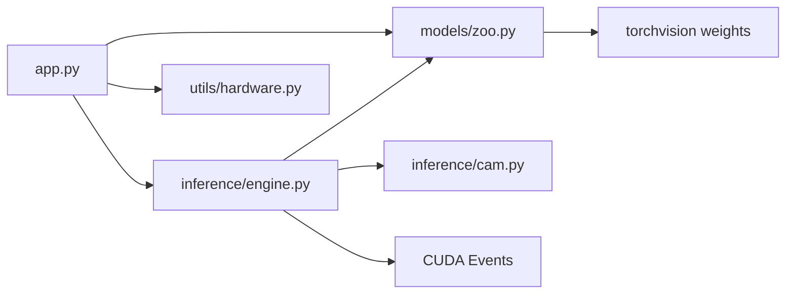

# Laboratório ImageNet — CNNs pré-treinadas

Bancada local para **experimentar, comparar e explicar** redes convolucionais já treinadas no ImageNet-1k. Não há treinamento e o dataset ImageNet não é baixado. Os pesos são os checkpoints oficiais do `torchvision` (`weights=…DEFAULT`), pedidos na primeira vez em que cada arquitetura é usada e reaproveitados no cache em disco do PyTorch.

A interface, em Gradio, oferece:

- um modelo por vez, com card de arquitetura, Top-5 e Grad-CAM;
- dois modelos lado a lado na mesma foto;
- um benchmark de latência com várias arquiteturas em sequência.

Arquiteturas: ResNet-18, ResNet-50, MobileNetV3-Large, EfficientNet-B0, ConvNeXt-Tiny e VGG-16.

## O que você precisa

- Python 3.10 ou mais novo (testado em 3.12).
- Para a GPU: placa NVIDIA com driver compatível com CUDA 12.6 ou superior. Veja a linha `CUDA Version` no `nvidia-smi`. Um número 12.6 ou maior (incluindo 13.x) serve para o wheel `cu126`.
- Não é preciso instalar o CUDA Toolkit. O wheel do PyTorch já traz o runtime.
- Alguns gigabytes livres em disco: o wheel do PyTorch passa de 2 GB e os seis checkpoints juntos ficam em torno de 1 GB.

Sem GPU NVIDIA, a mesma instalação roda em CPU. A latência deixa de usar `torch.cuda.Event` e o card deixa isso explícito. Em Mac com Apple Silicon, o PyTorch pode cair no backend MPS.

## Ambiente virtual

No PowerShell, a partir da pasta do projeto:

```powershell
py -3.12 -m venv .venv
.\.venv\Scripts\python.exe -m pip install --upgrade pip
.\.venv\Scripts\python.exe -m pip install -r requirements.txt
```

Se a política de execução impedir `Activate.ps1`, o caminho acima não precisa ativar o ambiente: chame o `python.exe` do `.venv` direto. Para ativar mesmo assim, só na janela atual:

```powershell
Set-ExecutionPolicy -Scope Process -ExecutionPolicy Bypass
.\.venv\Scripts\Activate.ps1
pip install -r requirements.txt
```

No Linux ou macOS:

```bash
python3 -m venv .venv
source .venv/bin/activate
python -m pip install --upgrade pip
python -m pip install -r requirements.txt
```

O `requirements.txt` aponta o índice `cu126` e fixa `torch==2.14.1+cu126` e `torchvision==0.29.1+cu126`. O sufixo `+cu126` é o que impede o pip de trocar esse wheel por outro build.

### CUDA 13.2

Se quiser o wheel mais novo e o driver informar CUDA 13.2 ou superior:

```powershell
.\.venv\Scripts\python.exe -m pip install torch==2.14.1+cu132 torchvision==0.29.1+cu132 --index-url https://download.pytorch.org/whl/cu132
```

Instale esse par **antes** do restante do `requirements.txt`, e não deixe o pip reinstalar o `torch` por cima. Na prática: instale o par CUDA 13.2 e, em seguida, instale só Gradio, Matplotlib e Plotly nas versões pinadas no arquivo.

### Wheel menor, só CPU

O wheel CUDA também executa em CPU quando não há GPU. Se o download de 2 GB for o problema e você não for usar NVIDIA:

```powershell
.\.venv\Scripts\python.exe -m pip install torch==2.14.1 torchvision==0.29.1
.\.venv\Scripts\python.exe -m pip install gradio==6.29.1 matplotlib==3.11.2 plotly==6.9.0 pillow==12.3.0 "numpy==2.5.2"
```

Confirme o dispositivo antes de abrir a interface:

```powershell
.\.venv\Scripts\python.exe -c "import torch; print(torch.__version__, torch.cuda.is_available(), torch.cuda.get_device_name(0) if torch.cuda.is_available() else 'cpu')"
```

Uma linha saudável se parece com `2.14.1+cu126 True NVIDIA GeForce …`.

## Executar

```powershell
.\.venv\Scripts\python.exe app.py
```

Abra [http://127.0.0.1:7860](http://127.0.0.1:7860). A primeira visita baixa ResNet-50 e MobileNetV3-Large; o card de latência preenche quando o download acaba.

```powershell
.\.venv\Scripts\python.exe app.py --host 127.0.0.1 --port 7860
.\.venv\Scripts\python.exe app.py --check
.\.venv\Scripts\python.exe app.py --share
```

`--check` carrega a ResNet-18, confere se o catálogo tem 1000 classes, mede a latência e roda o Grad-CAM na foto do cachorro. `--share` pede ao Gradio um link público temporário.

Forçar CPU mesmo com GPU disponível:

```powershell
$env:IMAGENET_VIZ_DEVICE = "cpu"
.\.venv\Scripts\python.exe app.py
```

## Como a bancada está organizada



| Arquivo | Papel |
|---|---|
| `app.py` | Interface Gradio em Blocks: inferência, comparação e benchmark. |
| `models/zoo.py` | Fábrica das seis CNNs, transforms oficiais e cache em memória. |
| `inference/engine.py` | `torch.inference_mode`, Top-5, latência e fallback de CUDA OOM. |
| `inference/cam.py` | Grad-CAM na última convolução com mapa espacial, em PyTorch puro. |
| `utils/hardware.py` | CUDA, MPS ou CPU, nome da placa e VRAM livre/alocada. |

O cache de pesos do PyTorch fica fora do repositório, em geral em `%USERPROFILE%\.cache\torch`. Apagar a pasta do projeto não apaga esses arquivos. O botão **Liberar VRAM** só tira os módulos da RAM/VRAM.

## O que observar

1. **ResNet-18 e ResNet-50 na mesma foto.** As duas usam atalho residual. A 50 troca o BasicBlock pelo Bottleneck. Compare parâmetros, GMACs, milissegundos e se o Top-1 muda.
2. **ResNet-50 e MobileNetV3-Large.** É o par da aba Comparação. A MobileNet usa convolução depthwise e tem bem menos GMACs. Numa GPU de desktop isso não garante menos milissegundos: os kernels depthwise são pequenos, não enchem a placa, e o custo de lançá-los pode comer a vantagem. O card mostra as duas contas de propósito. O Grad-CAM mostra se as duas olham para o mesmo objeto.
3. **VGG-16 no benchmark.** A pilha 3×3 mais o classificador denso concentram parâmetros. O número de MiB e a latência explicam por que essa família saiu de linha como extrator geral, mesmo quando o Top-1 publicado ainda parece competitivo ao lado de redes antigas.
4. **EfficientNet-B0 e ConvNeXt-Tiny.** Duas respostas diferentes ao mesmo problema: compound scaling com MBConv, e um bloco convolucional desenhado depois dos Transformers.

O Top-1 publicado no card é o número do checkpoint no torchvision, medido no centro de validação do ImageNet. Uma foto solta não reproduz essa acurácia. Ela serve para situar a arquitetura, não para auditar o checkpoint.

## Protocolo de medida

- Precisão **FP32**, layout **NCHW**, **batch 1**. Sem autocast, sem TensorRT e sem `channels_last`, para a diferença entre arquiteturas não se misturar com um kernel que só uma delas aproveita bem.
- **10** forwards de aquecimento ficam de fora da média. O cuDNN benchmark usa essa fase para escolher o algoritmo.
- **30** medições entram na média e no desvio. Em CUDA, cada uma é um par de `torch.cuda.Event` com sincronização no fim. Isso mede o tempo na GPU, não o tempo em que a CPU apenas enfileirou o trabalho.
- Em CPU ou MPS o relógio é `time.perf_counter`, com sincronização no MPS.
- TF32 fica ligado em GPU Ampere ou mais nova (série RTX 30 em diante) e vale para todos os modelos.
- GMACs contam multiplicações-adições de `Conv2d` e `Linear` numa imagem. GFLOPs ≈ 2 × GMACs. Batch norm, ativação e pooling não entram.
- O pico de ativação é `max_memory_allocated − memória já alocada`, depois de um `empty_cache`, **fora** do cronômetro.

O card do modelo mede um tensor sintético. A classificação mede a foto já pré-processada. Com o mesmo formato, os dois números ficam próximos; os dois aparecem para não esconder qual entrada foi usada.

## Grad-CAM

O mapa explica a classe Top-1:

1. Um forward de sondagem escolhe o último tensor que ainda tem altura e largura: a saída do último bloco, ou do pooling no caso da VGG. O mapa é o que segue para o classificador, não uma convolução crua antes da ReLU.
2. Outro forward guarda as ativações e o backward parte do logit dessa classe.
3. O peso de cada canal é a média espacial do gradiente. O mapa é a ReLU da soma ponderada.
4. A figura mostra o recorte que a rede viu, o heatmap e a sobreposição. Azul contribui pouco; vermelho contribui muito.

ReLUs inplace são desligadas no carregamento. Com elas ligadas, a ativação é reescrita antes do backward e o mapa sai errado.

Se o backward não couber na VRAM, a predição permanece na GPU e o mapa é calculado numa cópia em CPU. O aviso fica no resultado.

## Memória da GPU

O carregamento tenta a GPU três vezes: direto, depois de esvaziar o cache e depois de descarregar os outros modelos. Se ainda assim faltar memória, aquele modelo passa para a CPU até você clicar em **Liberar VRAM**. Latência de CPU e latência de CUDA não devem ser comparadas; a interface diz quando os dispositivos diferem.

Fechar outros processos que usem a placa também devolve VRAM. O `nvidia-smi` mostra o consumo do lado de fora deste processo.

## Imagens de exemplo

| Arquivo | Origem |
|---|---|
| `assets/examples/cachorro.jpg` | Amostra distribuída com o [PyTorch Hub](https://github.com/pytorch/hub/blob/master/images/dog.jpg). |
| `assets/examples/aviao.jpg` | Wikimedia Commons, [Thai Airways International Boeing 747-4D7 HS-TGP MUC 2015 03.jpg](https://commons.wikimedia.org/wiki/File:Thai_Airways_International_Boeing_747-4D7_HS-TGP_MUC_2015_03.jpg), recorte de 640 px. |
| `assets/examples/cafe.jpg` | Wikimedia Commons, [A small cup of coffee.JPG](https://commons.wikimedia.org/wiki/File:A_small_cup_of_coffee.JPG), recorte de 640 px. |

As fotos da Commons seguem a licença indicada na página de cada arquivo.

## Problemas frequentes

**`torch.cuda.is_available()` é `False`.** O driver não está visível ou o pip instalou outro build. Rode o `nvidia-smi` e o comando de conferência acima. Se a versão do torch não terminar em `+cu126` (ou `+cu132`), reinstale o par do índice da NVIDIA.

**A interface abre e o card não ganha latência.** A primeira execução está baixando o checkpoint. O terminal mostra a barra de progresso do torchvision. Sem rede, só modelos já presentes no cache do PyTorch carregam.

**CUDA out of memory.** Use Liberar VRAM, prefira ResNet-18 ou MobileNetV3-Large, ou feche o que mais estiver na placa. A aplicação não encerra por esse erro: ela registra o aviso e, se precisar, continua em CPU.

**A classe prevista parece absurda.** Confira se a foto realmente contém o objeto e lembre que o nome vem das 1000 classes em inglês do ImageNet. O Grad-CAM ajuda a ver se a rede olhou para o objeto ou para o fundo.
